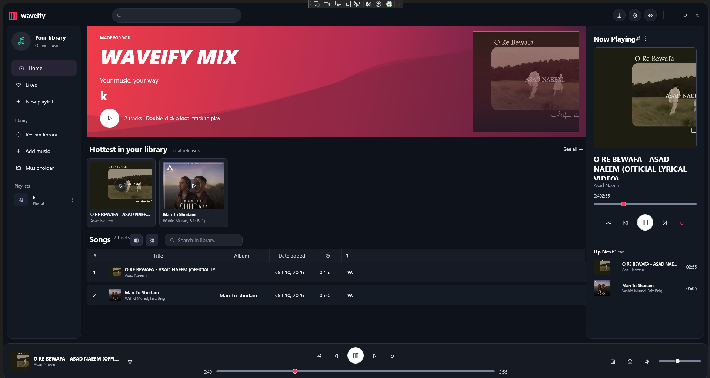

# Waveify



Waveify is a Windows desktop music player for building and enjoying an offline music library. It combines local playback, playlist management, metadata cleanup, lyrics lookup, and optional authorized download tooling in a polished WPF interface.

## Product Features

- Local music library with import, rescan, missing-file cleanup, and managed music folder support.
- Rich playback controls with play/pause, next/previous, shuffle, repeat, seeking, volume, and output-device selection.
- Playlists, liked songs, right-click track actions, and queue-oriented "Up Next" views.
- Album artwork loading from embedded tags, cached artwork files, and remote metadata where available.
- Metadata enrichment for imported tracks.
- Lyrics lookup and local `.lrc` lyric file storage.
- Batch URL import for supported authorized sources.
- Optional tool setup window for downloader dependencies.
- Restores volume, output device, repeat mode, last track, and playback position between sessions.


## Library and playback features

- Sort songs using the library dropdown: playlist order, title, artist, or newest added.
- In a playlist, drag a song onto another row to reorder it; the order is saved automatically. Select **Playlist order** to see the saved order.
- Right-click a song to edit its title, artist, album, and genre. These edits update Waveify's library metadata (they do not rewrite the audio file tags).
- **Recently Added** displays the 50 newest imports, and **Recently Played** keeps the last 100 distinct tracks between launches.
- Home offers artist, album, and genre shelves. Double-click a shelf track to play it.
- The Now Playing panel has Bass, Mid and Treble sliders, with equalizer presets and a top-bar toggle.
- Keyboard shortcuts: **Space** play/pause, **Ctrl+F** search, **Ctrl+O** import files, **Ctrl+Right** next, and **Ctrl+Left** previous.

## Additional controls

- Toggle list and grid views above the song table.
- The **Up Next** panel displays upcoming queue tracks; double-click to play, move tracks up, remove individual entries, or clear upcoming tracks. The bottom Queue button toggles the panel.
- Use the playlist options menu to rename, duplicate, delete, or choose a cover image. Playlist song counts appear in the sidebar.
- Filter the library by artist, album, genre, year, liked songs, and available local files. Applied filters are saved between launches.
- Open **Most Played** to see play counts and last-played times.
- The metadata editor offers to write edited fields into supported local audio files.
- The equalizer has bass, midrange, and treble controls with Flat, Rock, Vocal, and Electronic presets.
- Media-key events are handled when Waveify has keyboard focus; Ctrl+M toggles mute. System-wide media controls and configurable shortcuts are not yet implemented.

## Quick discovery and song actions

- **Surprise me** plays a random local song from the library.
- **Unplayed** lists tracks with zero plays; **Possible duplicates** finds matching title-and-artist entries for review without automatically deleting files.
- Right-click a song to **Play next**, copy its details, or reveal its local file in Windows Explorer.
- Open the playlist options menu to **Export M3U** for locally available tracks, preserving playlist order.

## Unified music search and downloads

- Use the **single search box in the top bar** to search by title, artist, album or genre. Local tracks are grouped under **Offline**; saved online links and live search results appear under **YouTube**, **SoundCloud**, and **Spotify**.
- Search results appear in one central pane, replacing the normal browsing view while a search is active. **Clear search** returns to library browsing; choosing a sidebar view also closes search.
- **YouTube search runs inside Waveify using yt-dlp.** Pause typing in the top search box briefly to load up to 10 real video results with titles, channels, and thumbnails, or click **Search YouTube** to retry. Click a result to open it in the browser or use its **Download** button for audio you own or are authorized to save.
- **SoundCloud search also runs inside Waveify using yt-dlp**, showing up to 10 public track results with titles, uploaders, and available artwork. The same top search field triggers both YouTube and SoundCloud searches; click **Search SoundCloud** to retry. Open a track on SoundCloud or click its **Download** button for audio you have permission to save.
- **Spotify search runs inside Waveify using the optional Python [`ddgs`](https://pypi.org/project/ddgs/) package.** It searches public web-indexed Spotify track, album, and playlist pages, showing up to 10 valid results in the Spotify section. Click **Search Spotify** to retry, click a result to open it, or use its **Download** button when you have permission to save the audio. These results are from web search, not Spotify's official search API.
- YouTube and SoundCloud discovery require yt-dlp, installed through **Setup tools** or on PATH. Spotify discovery requires Python 3.10 or newer and `ddgs`: run `py -3 -m pip install -U ddgs` in Windows PowerShell (or `python -m pip install -U ddgs` if you do not have the Python launcher). All discovery requests return metadata or public web links, time out after 30 seconds, and cancel when the query changes. If Python or `ddgs` is missing, the Spotify section displays setup guidance. Search results may be incomplete due to web-index availability.
- Use the **Import a music link** controls in the results pane to paste a provider URL, preview available public metadata and import audio you own or are authorized to download.
- Authorized downloads use the existing tools: yt-dlp and FFmpeg for supported YouTube/SoundCloud URLs, Sunnify for supported Spotify URLs, and a 150 MB limit on direct HTTPS audio files.
- Downloader availability, music rights, and service restrictions still apply. Searching does not automatically download music.

## Dependencies

Waveify targets Windows and requires:

- Windows 10 or later.
- [.NET 8 SDK](https://dotnet.microsoft.com/download/dotnet/8.0) to build from source.
- .NET 8 Desktop Runtime to run framework-dependent builds.

NuGet packages used by the app:

- [WPF-UI](https://github.com/lepoco/wpfui) for the Fluent WPF controls.
- [NAudio](https://github.com/naudio/NAudio) for audio playback and output-device support.
- [TagLibSharp](https://github.com/mono/taglib-sharp) for audio metadata and embedded artwork.

Optional tools for authorized downloads:

- `yt-dlp`
- `ffmpeg`
- `deno`
- `Sunnify-Windows-CLI`

Waveify can install these optional tools into its local tools folder from their official GitHub releases. The player still works without them for local music playback.

## Build

```powershell
dotnet restore
dotnet build -c Release
```

## Run

```powershell
dotnet run -c Release
```

## Publish

Create a Windows publish folder:

```powershell
dotnet publish Waveify.csproj -c Release -r win-x64 --self-contained true -p:PublishSingleFile=true -p:IncludeNativeLibrariesForSelfExtract=true -o publish/win-x64
```

The app executable will be created in `publish/win-x64`.

## GitHub Release Workflow

This repository includes a GitHub Actions workflow at `.github/workflows/release.yml`.

To create a release:

```powershell
git tag v1.0.0
git push origin v1.0.0
```

The workflow publishes a self-contained Windows x64 build, packages it as `Waveify-win-x64.zip`, uploads it as a workflow artifact, and attaches it to the GitHub Release.
